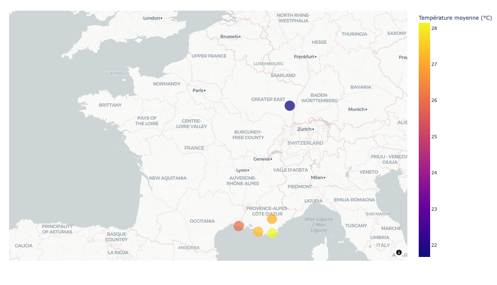
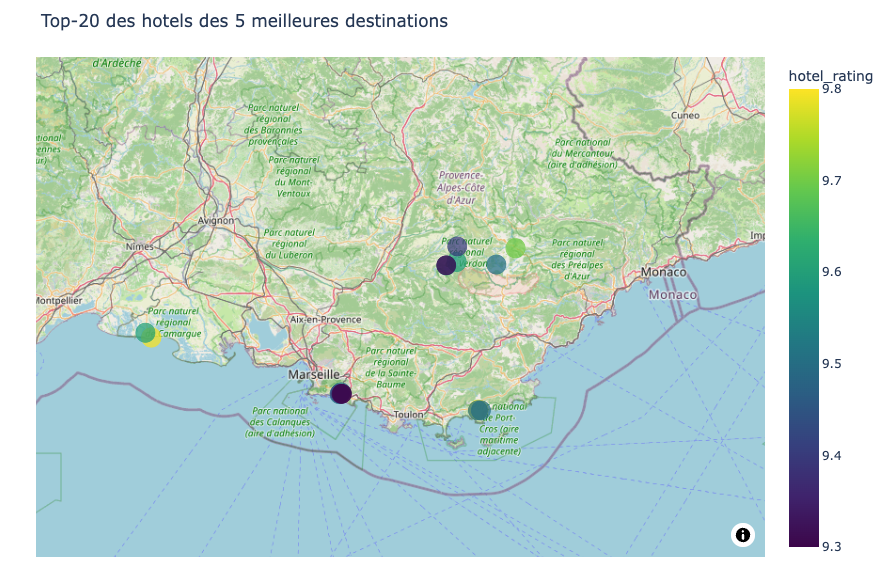
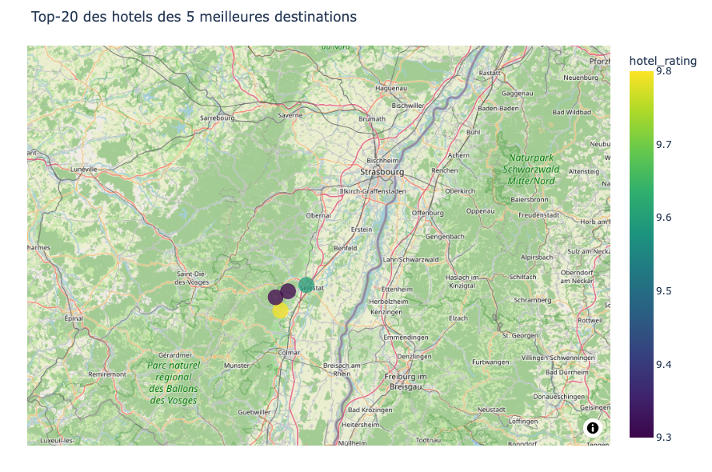

::: {.page-titre}
Plan your trip with Kayak

Bloc 1 : Construction et alimentation d'une infrastructure de gestion de données

Julien Jorge

Octobre 2026
:::

## Le projet

L'équipe marketing de Kayak souhaite une application qui recommande à ses utilisateurs
où partir en vacances, à partir de données réelles sur la météo et sur les hôtels
disponibles. Au départ, aucune donnée n'existe : notre travail consiste à les collecter,
à les stocker dans un data lake, puis à les nettoyer et à les charger dans une base de
données pour qu'elles soient exploitables.

Le périmètre est limité aux 35 destinations françaises choisies par l'équipe marketing.
Le résultat attendu est un classement des cinq destinations où la météo des prochains
jours est la plus favorable, et pour chacune une sélection d'hôtels, le tout présenté
sur deux cartes.

Ce projet est réalisé dans le cadre de la certification Concepteur Développeur en
Science des Données de Jedha, bloc 1 : construction et alimentation d'une
infrastructure de gestion de données.

## Les données

Aucune donnée n'a été fournie : tout a été collecté par le code, auprès de trois sources.

- **Nominatim** (OpenStreetMap) : un service de géocodage gratuit, qui transforme
  le nom de chaque destination en coordonnées GPS. Nous en tirons la latitude,
  la longitude et l'adresse complète des 35 destinations.
- **OpenWeather** (API One Call) : les prévisions météo à 7 jours pour chaque
  destination. Nous en calculons trois indicateurs : le cumul de pluie, la
  température moyenne en journée et la couverture nuageuse moyenne. Les valeurs
  utilisées ont été relevées le 3 septembre 2026.
- **Booking.com** : pour chacune des cinq destinations retenues, les 25 hôtels de
  la première page de résultats, soit 125 hôtels. Pour chacun : le nom, l'adresse
  de sa page Booking, ses coordonnées, sa note et sa description. Cette collecte
  est faite par scraping, les autres par appel d'API.

## Comment ça marche

Tout le travail est dans le notebook, en sept étapes :

1. **Géocodage** : les 35 destinations sont transformées en coordonnées GPS avec
   Nominatim.
2. **Météo et score** : les prévisions à 7 jours sont récupérées pour chaque
   destination, puis combinées en un score de beau temps. Les cinq meilleurs scores
   donnent le Top-5, affiché sur une première carte.
3. **Collecte des hôtels** : une spider Scrapy récupère 25 hôtels par destination
   du Top-5 sur Booking.com.
4. **Nettoyage** : les données sont mises en forme en deux tables, les destinations
   et les hôtels, reliées par l'identifiant de destination.
5. **Data lake** : les fichiers bruts et les fichiers nettoyés sont déposés dans un
   bucket S3, dans deux dossiers séparés.
6. **Entrepôt de données** : les deux tables sont créées puis chargées dans une base
   PostgreSQL hébergée sur Amazon RDS.
7. **Exploitation** : une requête SQL sur l'entrepôt donne le Top-20 des hôtels,
   affiché sur une seconde carte.

### Les choix importants du projet

- **La règle de beau temps.** L'énoncé ne la définit pas. Nous avons construit un
  score sur trois indicateurs, pondérés selon leur importance pour un touriste :
  la pluie pour moitié, l'écart à une température idéale de 22 °C pour 30 %, la
  couverture nuageuse pour 20 %.
- **Le contournement de la protection anti-robots de Booking.** Le site ne sert ses
  pages qu'à un navigateur ayant résolu une épreuve JavaScript. Nous ouvrons donc
  la page dans un navigateur, qui résout l'épreuve, puis nous relevons le jeton
  qu'il a obtenu pour le donner à la spider. Cela suffit pour cinq requêtes.
- **Des collectes jouées une seule fois.** La météo change chaque jour et le jeton
  Booking expire. Chaque étape de collecte recharge donc son fichier s'il existe
  déjà, au lieu de rappeler la source : le Top-5 et les hôtels restent cohérents
  d'une exécution à l'autre.

## Les résultats

Les cinq destinations retenues, pour la semaine suivant le 3 septembre 2026 :

| Destination | Pluie sur 7 jours (mm) | Température moyenne (°C) | Nuages (%) | Score |
|---|---|---|---|---|
| Saintes Maries de la mer | 0,2 | 25,9 | 28 | 0,82 |
| Château du Haut Koenigsbourg | 2,9 | 21,7 | 64 | 0,79 |
| Cassis | 0,0 | 27,3 | 25 | 0,79 |
| Gorges du Verdon | 0,0 | 27,1 | 29 | 0,79 |
| Bormes les Mimosas | 0,0 | 28,2 | 24 | 0,76 |

Quatre des cinq destinations sont dans le Sud-Est ; le Château du Haut Koenigsbourg
s'y glisse grâce à une température proche des 22 °C visés, malgré un ciel plus couvert.



Pour ces cinq destinations, 125 hôtels ont été collectés, dont 2 sans note. Le Top-20
des hôtels, obtenu par une requête sur l'entrepôt, regroupe les hôtels notés de 9,3
à 9,8 sur 10.

Les deux tables de l'entrepôt :

- **cities** : 35 lignes, une par destination, avec ses coordonnées, ses trois
  indicateurs météo et son score ;
- **hotels** : 125 lignes, une par hôtel, rattachée à sa destination par une clé
  étrangère.

Les deux cartes sont interactives dans le notebook, en fin d'étape 2 et en fin d'étape 7 ;
la seconde est reproduite ici en deux vues, le Sud-Est et l'Alsace.





## Exécuter le projet

### Contenu du dépôt

```
kayak/
├── 01-Plan_your_trip_with_Kayak.ipynb   le notebook, livrable principal
├── src/booking_spider.py                la spider Scrapy pour Booking.com
├── data/processed/                      les fichiers produits par le notebook
├── .env.example                         la liste des variables à renseigner
└── README.md
```

### Prérequis

- Python 3.13 avec les bibliothèques pandas, requests, scrapy, boto3, sqlalchemy,
  psycopg, plotly et python-dotenv.
- Un compte AWS avec un bucket S3, une instance PostgreSQL sur RDS et un utilisateur
  IAM autorisé à écrire dans le bucket. Ces ressources sont créées à la main dans la
  console AWS : le notebook les alimente, il ne les crée pas.
- Une clé d'API OpenWeather (offre One Call).

### Configuration

Copier le fichier .env.example en .env et renseigner chaque variable. Le fichier
indique pour chacune où trouver sa valeur. Le fichier .env contient des secrets :
il n'est pas versionné et ne doit jamais l'être.

### Lancement

Ouvrir le notebook et exécuter toutes les cellules, depuis la racine du projet.

Les fichiers de data/processed/ sont fournis : les trois collectes (géocodage, météo,
hôtels) ne sont pas relancées, et le notebook s'exécute en moins d'une minute. Pour
recollecter, supprimer le fichier concerné dans data/processed/. Attention pour les
hôtels : il faut au préalable relever un jeton Booking valide, comme expliqué dans
le notebook, et une nouvelle collecte météo change le Top-5, donc les destinations
pour lesquelles il faut collecter les hôtels.

## Limites et suites possibles

- **Une météo figée.** Le classement repose sur les prévisions du 3 septembre 2026.
  Une vraie application recollecterait la météo chaque jour et recalculerait le Top-5.
- **Un jeton Booking à renouveler à la main.** La collecte des hôtels dépend d'un jeton
  relevé dans un navigateur, qui expire en quelques heures. Elle ne peut donc pas être
  automatisée telle quelle.
- **25 hôtels par destination, sans tri.** Ce sont ceux de la première page de résultats
  de Booking, dans son ordre. Une version plus complète parcourrait plusieurs pages et
  filtrerait selon des critères (prix, type d'hébergement).
- **Des pondérations choisies à la main.** Les poids du score (50 % pluie, 30 %
  température, 20 % nuages) relèvent du bon sens. Une version aboutie les calibrerait
  sur des données réelles de réservation.
- **Un volume modeste.** 35 destinations et 125 hôtels tiennent dans une base
  PostgreSQL classique. Pour toute la France ou l'Europe, il faudrait un entrepôt
  conçu pour l'analyse de gros volumes, comme Amazon Redshift, et paralléliser les
  collectes.
